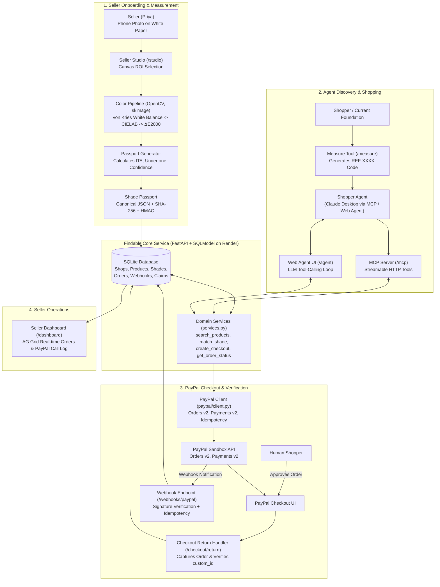
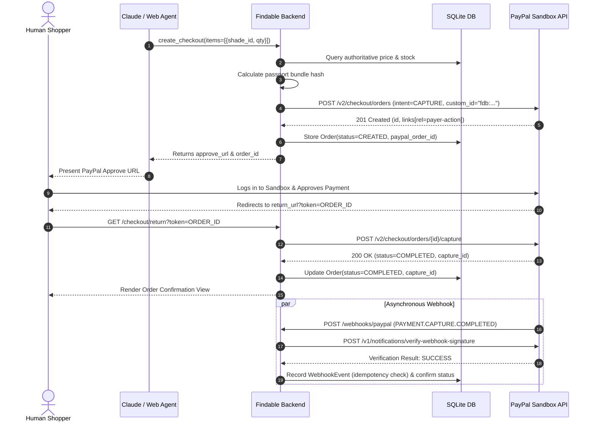
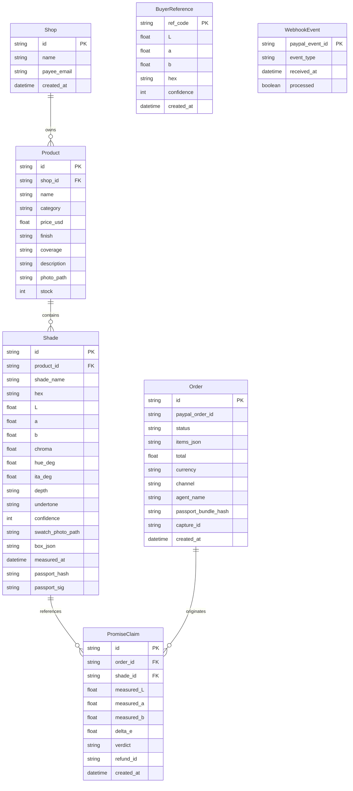

# Findable: System Architecture & Technical Specification

> *"Toffee isn't a colour. ΔE 1.8 is."*

Findable turns a single phone photograph of a beauty brand's swatches on standard white paper into mathematically measured, cryptographically signed **Shade Passports** that autonomous AI shopping agents (via MCP or Web Agent) can accurately discover, compare, and purchase through PayPal.

---

## 1. High-Level Architecture Diagram



---

## 2. Core Subsystems & Components

### 2.1 Color Science & Calibration Engine (`app/color/`)
The foundation of Findable is physical color consistency across arbitrary consumer phone cameras and ambient lighting conditions.

1. **Reference Standard**: Standard 80gsm white printer paper is used as the neutral diffuser reference ($\approx L^* 94, a^* 0, b^* 0$).
2. **Linearization**: sRGB camera inputs are inverted to linear RGB space:
   $$C_{\text{linear}} = \begin{cases} \frac{C_{\text{srgb}}}{12.92} & C_{\text{srgb}} \le 0.04045 \\ \left(\frac{C_{\text{srgb}} + 0.055}{1.055}\right)^{2.4} & \text{otherwise} \end{cases}$$
3. **von Kries White Balance**: Linear RGB channels are scaled against the median non-clipped paper pixels:
   $$\text{RGB}_{\text{corrected}} = \text{RGB}_{\text{linear}} \times \frac{0.85}{\text{RGB}_{\text{paper}}}$$
4. **Outlier-Filtered Sampling**: The inner 60% of each swatch bounding box is extracted. Pixels in the top/bottom 10th percentile of $L^*$ (glare and paper grain) are discarded.
5. **CIELAB Transformation & CIEDE2000 Distance**: Converted to D65 CIELAB coordinates $(L^*, a^*, b^*)$. Distance between swatches is evaluated via the $\Delta E_{00}$ metric.
6. **Individual Typology Angle (ITA)**:
   $$\text{ITA}^{\circ} = \arctan\left(\frac{L^* - 50}{b^*}\right) \times \frac{180}{\pi}$$
   Bucketed into depth categories:
   - Very Light: $> 55^\circ$
   - Light: $41^\circ - 55^\circ$
   - Medium: $28^\circ - 41^\circ$
   - Tan: $10^\circ - 28^\circ$
   - Deep: $-30^\circ - 10^\circ$
   - Rich: $< -30^\circ$
7. **Undertone Classification**: Hue angle $h = \text{atan2}(b^*, a^*)$:
   - Warm: $h \ge 62^\circ$
   - Neutral: $55^\circ \le h < 62^\circ$
   - Cool: $h < 55^\circ$

---

### 2.2 Shade Passport Cryptographic Specification (`app/passport.py`)
To prevent hallucination, listing drift, or agent deception, every shade profile is serialized into a deterministic, signed **Shade Passport**.

```json
{
  "passport_version": "1.0",
  "shade_id": "shd_honey04",
  "product": {
    "id": "prd_skin_tint",
    "name": "Skin Tint Foundation",
    "category": "foundation",
    "price": { "value": "24.00", "currency": "USD" }
  },
  "shade_name": "Honey 04",
  "measured": {
    "hex": "#C08C6C",
    "lab": [62.4, 13.9, 24.1],
    "chroma": 27.8,
    "hue_deg": 60.0,
    "ita_deg": 27.2
  },
  "labels": {
    "depth": "tan",
    "undertone": "neutral"
  },
  "confidence": 91,
  "method": {
    "reference": "white paper",
    "illuminant": "D65",
    "delta_e": "CIEDE2000",
    "pipeline": "findable-color 0.1"
  },
  "measured_at": "2026-11-10T19:30:00Z",
  "hash": "sha256:7f83b1657ff1fc53b92dc18148a1d65dfc2d4b1fa3d677284addd200126d9069",
  "signature": "hmac-sha256:e3b0c44298fc1c149afbf4c8996fb92427ae41e4649b934ca495991b7852b855"
}
```

- **Canonical Hash**: SHA-256 computed on canonical JSON (keys sorted alphabetically, no extra whitespace) omitting the `hash` and `signature` fields.
- **HMAC Signature**: HMAC-SHA256 signature generated using `PASSPORT_SECRET`.
- **PayPal Linkage**: When an agent orders a shade, the passport bundle hash is stamped into PayPal's `custom_id` field (prefixed with `fdb:`). This cryptographically links the monetary charge to the exact optical measurement viewed by the AI agent.

---

### 2.3 Model Context Protocol (MCP) Server (`app/mcp_server.py`)
The MCP server exposes streamable HTTP tools over the standard protocol mounted at `/mcp`, allowing Claude Desktop or external shopping agents to act as trusted buyers.

| Tool Name | Parameters | Returns | Security & Invariants |
|-----------|------------|---------|-----------------------|
| `search_products` | `query`, `category`, `max_price`, `undertone`, `depth`, `limit` | List of candidate products with shade counts and verified passport badges | Read-only. Prices queried strictly from database. |
| `match_shade` | `reference` (ref_code / hex / lab), `category`, `max_price`, `limit` | Ranked matching shades with calculated $\Delta E$, undertone delta, match rating, and explanation | Read-only. Algorithmic ranking via CIEDE2000. |
| `get_shade_passport` | `shade_id` | Signed JSON Shade Passport document | Verifiable cryptographic proof of shade data. |
| `create_checkout` | `items` (shade_id + quantity), `agent_name` | `order_id`, `approve_url`, `total`, `currency` | Server-authoritative pricing. Agent cannot capture or move funds. |
| `get_order_status` | `order_id` | `status` (`CREATED`, `APPROVED`, `COMPLETED`, `REFUNDED`), `capture_id` | Enforces that agent cannot mark order "paid" until status is `COMPLETED`. |
| `open_shade_promise` | `order_id`, `shade_id`, `ref_code` | Measured $\Delta E$, outcome (`REFUND`, `EXCHANGE`, `REJECTED`), `refund_id` | Automated, zero-friction PayPal refund upon optical mismatch. |

---

### 2.4 PayPal Integration Architecture (`app/paypal/`)



---

## 3. Database Entity Relationship Model



---

## 4. Frontend Application Map

| Route | View Name | Primary Function |
|-------|-----------|------------------|
| `/studio` | Seller Studio | Upload flat-lay swatch photograph, interactively draw paper reference box and shade swatches on HTML5 Canvas, view real-time raw vs corrected color chips, and commit to AG Grid. |
| `/agent` | AI Shopping Agent | Conversational shopping interface with dual-input (natural language + swatch photo upload). Emits interactive match cards, $\Delta E$ gauges, and PayPal checkout triggers. Contains collapsible "Behind the Scenes" inspection console. |
| `/dashboard` | Seller Operations | Real-time merchant dashboard powered by AG Grid Community displaying orders received via AI agents/web, passport verification badges, and live PayPal API call telemetry. |
| `/shop/{shop_id}` | Direct Storefront | Clean customer-facing catalog showcasing shade swatches with calibrated digital chips and direct PayPal Smart Buttons. |
| `/measure` | Reference Tool | Dedicated mobile-friendly camera utility for shoppers to swatch their current makeup and receive a permanent `REF-XXXX` identifier. |
| `/passport/{shade_id}` | Passport Inspector | Public cryptographic verification page displaying raw CIELAB coordinates, ITA angles, and HMAC validation status. |
| `/judges` | Hackathon Evaluator Walkthrough | One-click demo initialization, pre-seeded sample data, step-by-step evaluation checkpoints, and sandbox credentials guide. |
| `/promise/{order_id}` | Shade Promise Portal | Post-purchase dispute resolution interface allowing instant photographic verification and automated PayPal refund execution. |

---

## 5. Security & Idempotency Guarantees

1. **Server-Authoritative Pricing**: Agent requests can specify `shade_id` and `quantity`, but item prices and order totals are unconditionally resolved against the internal SQLite database.
2. **PayPal Request Idempotency**: All mutating operations (`create_order`, `capture_order`, `refund_order`) transmit deterministic `PayPal-Request-Id` headers.
3. **Webhook Verification**: Incoming webhook payloads are validated against PayPal's public keys via `/v1/notifications/verify-webhook-signature` before any state transition.
4. **Offline Resilience**: When `MOCK_PAYPAL=1` is configured, mock tokens and simulation endpoints activate, ensuring end-to-end local testing without external internet dependencies.
