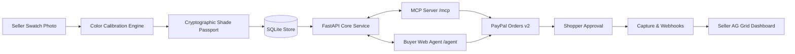

# Findable

> **"Toffee isn't a colour. ΔE 1.8 is."**
>
> One phone photo turns a small beauty brand's swatches into measured, cryptographically verifiable shade data that AI shopping agents can match, compare, and purchase directly through PayPal.

[](LICENSE)
[](https://www.python.org/downloads/)
[](https://fastapi.tiangolo.com)
[](https://developer.paypal.com)
[](https://modelcontextprotocol.io)
[](https://www.ag-grid.com)

---

## The Problem

- **Small brands use subjective names**: Independent beauty brands name their shades "Honey", "Toffee", or "Almond". A name is not an optical coordinate. AI shopping agents cannot match subjective naming against a customer's complexion, routinely routing buyers toward conglomerate brands with proprietary shade-matching apps.
- **High Return Rates**: Foundation and concealer have an e-commerce return rate of ~23%, overwhelmingly driven by shade and undertone mismatch (*Eightx benchmarks*).
- **Cart Abandonment**: 60% of online shoppers hesitate to buy foundation without an objective shade validation tool (*Arbelle*).

---

## The Solution: Findable

Findable empowers small indie sellers like Priya to create **Shade Passports** using nothing more than a smartphone photograph:
1. **Physical Normalization**: Swatches are photographed alongside standard printer paper as a lighting calibration standard.
2. **Computer Vision Calibration**: Inverts sRGB, computes von Kries linear channel balancing against the paper reference, strips texture/glare outliers, and maps values to CIELAB $(L^*, a^*, b^*)$ under standard D65 illuminant.
3. **Derived Metrics**: Calculates Individual Typology Angle ($\text{ITA}^\circ$), depth classification, hue angle undertone (Warm, Neutral, Cool), and measurement confidence index.
4. **Shade Passport Cryptography**: Every shade is packaged into a canonical JSON passport, hashed with SHA-256, and signed via HMAC.
5. **Autonomous Agent Purchasing via MCP**: An MCP server mounts at `/mcp`, permitting agents like Claude Desktop to search products, match shades using mathematical CIEDE2000 color difference ($\Delta E_{00}$), and initialize server-priced PayPal checkouts.
6. **PayPal Checkout & Verified Webhooks**: The agent generates the order; human shoppers approve in PayPal. Capture returns verify the transaction, and cryptographic webhook signatures post the order to the seller's AG Grid dashboard.
7. **Shade Promise (Automated Dispute Resolution)**: If a customer claims a mismatch, they re-photograph the swatch. If the measured $\Delta E_{00}$ exceeds tolerance, an automated PayPal refund is disbursed in seconds without manual disputes.

---

## System Architecture



For full sequence diagrams, mathematical formulas, and data models, see [ARCHITECTURE.md](ARCHITECTURE.md).

---

## Tech Stack

| Layer | Component | Description |
|---|---|---|
| **Backend** | Python 3.11+, FastAPI, Uvicorn, SQLModel | Single high-performance asynchronous service |
| **Frontend** | Jinja2 Templates, Tailwind CSS (CDN), Vanilla JS / HTMX | Server-rendered, responsive, zero-build toolchain |
| **Grids & Tables** | AG Grid Community (CDN) | Interactive seller shade catalogue & real-time order stream |
| **Color Science** | OpenCV (headless), NumPy, scikit-image | von Kries white balancing, CIELAB conversion, $\Delta E_{00}$ |
| **Agent / MCP** | FastMCP, Anthropic Claude / Google Gemini SDK | Streamable HTTP endpoint at `/mcp` & conversational web agent |
| **Payments** | PayPal REST APIs (v2 Orders, v2 Payments, Webhooks) | Secure server-side order creation, captures, refunds, webhooks |
| **Database** | SQLite + SQLModel ORM | Embedded relational database with automatic seed data |
| **Deployment** | Render (`render.yaml`) | Instant deployable cloud blueprint |

---

## Repository Structure

```text
.
├── ARCHITECTURE.md              # Detailed architecture, flows, and color maths
├── README.md                    # Project overview, setup, and submission guide
├── requirements.txt             # Python runtime dependencies
├── render.yaml                  # Render deployment blueprint
├── .env.example                 # Example configuration template
├── LICENSE                      # MIT Open Source License
├── app/
│   ├── main.py                  # FastAPI entry point, page & API routes, mounts /mcp
│   ├── config.py                # Pydantic Settings configuration loader
│   ├── db.py                    # SQLite database engine & session dependency
│   ├── models.py                # SQLModel table definitions (Shop, Product, Shade, Order, etc.)
│   ├── passport.py              # Canonical JSON hashing & HMAC signing engine
│   ├── services.py              # Search, match, checkout, status, promise service layer
│   ├── mcp_server.py            # FastMCP streamable HTTP tool server definitions
│   ├── color/
│   │   ├── __init__.py
│   │   ├── pipeline.py          # White balance, crop, linearize, LAB conversion
│   │   └── metrics.py           # ITA, depth, undertone, confidence, and ΔE2000 metrics
│   ├── llm/
│   │   ├── __init__.py
│   │   ├── client.py            # Vision & LLM tool wrapper (Claude / Gemini)
│   │   ├── listing.py           # Product photo + seller caption -> listing generator
│   │   └── agent.py             # Shopper conversational agent tool-calling loop
│   ├── paypal/
│   │   ├── __init__.py
│   │   ├── client.py            # PayPal Orders v2, Payments v2, OAuth token cache
│   │   └── webhooks.py          # PayPal webhook signature verification & idempotency
│   ├── templates/               # Jinja2 HTML templates
│   │   ├── base.html            # Global layout with Tailwind CDN and navigation
│   │   ├── studio.html          # Seller photo upload, canvas box drawing & AG Grid
│   │   ├── agent.html           # Shopper conversational agent & match cards
│   │   ├── dashboard.html       # Seller orders & PayPal API call telemetry
│   │   ├── shop.html            # Public storefront with PayPal Smart Buttons
│   │   ├── measure.html         # Shopper current-foundation calibration tool
│   │   ├── passport.html        # Public Shade Passport verification page
│   │   ├── judges.html          # 3-minute hackathon judge evaluation walkthrough
│   │   └── promise.html         # Automated Shade Promise dispute resolution portal
│   └── static/                  # Static assets
│       ├── css/styles.css       # Custom styles
│       └── js/
│           ├── studio.js        # HTML5 Canvas ROI drawing & swatch selector
│           ├── agent.js         # Chat UI and Behind-the-Scenes telemetry logger
│           └── dashboard.js     # AG Grid initializers & event streams
├── bench/                       # Benchmarking suite
│   ├── run.py                   # Tri-condition accuracy & lighting benchmark script
│   ├── queries.json             # 20 standardized foundation query profiles
│   └── results.csv              # Benchmark execution metrics output
├── data/
│   └── seed/                    # Seed data
│       └── seed_data.json       # Preloaded indie beauty brand catalog (Priya's Shop)
└── tests/                       # Unit and integration test suites
    ├── __init__.py
    ├── test_color.py            # Tests for color conversion and ΔE2000 accuracy
    ├── test_passport.py         # Tests for canonical hashing and HMAC verification
    └── test_paypal.py           # Tests for PayPal client payload and mock execution
```

---

## Quickstart & Local Setup

### 1. Prerequisites
- Python 3.11 or higher
- Git

### 2. Installation
```bash
# Clone the repository
git clone https://github.com/your-username/findable.git
cd findable

# Create and activate a virtual environment
python -m venv .venv
# On Windows:
.venv\Scripts\activate
# On macOS/Linux:
source .venv/bin/activate

# Install dependencies
pip install -r requirements.txt
```

### 3. Configure Environment Variables
Copy the template configuration file:
```bash
cp .env.example .env
```
Edit `.env` with your sandbox keys:
```env
# PayPal Sandbox Credentials
PAYPAL_CLIENT_ID=your_sandbox_client_id
PAYPAL_CLIENT_SECRET=your_sandbox_client_secret
PAYPAL_BASE_URL=https://api-m.sandbox.paypal.com
PAYPAL_WEBHOOK_ID=your_webhook_id

# AI / LLM Configuration
LLM_PROVIDER=anthropic  # or gemini
LLM_API_KEY=your_api_key
LLM_MODEL=claude-3-5-sonnet-20241022

# Application Settings
APP_BASE_URL=http://localhost:8000
DATABASE_URL=sqlite:///findable.db
PASSPORT_SECRET=replace_with_a_random_32_byte_hex_string
MOCK_PAYPAL=0  # Set to 1 to run fully offline without real PayPal credentials
```

### 4. Run the Application
```bash
uvicorn app.main:app --reload --host 0.0.0.0 --port 8000
```
Navigate in your browser to:
- **Seller Studio**: [http://localhost:8000/studio](http://localhost:8000/studio)
- **AI Shopping Agent**: [http://localhost:8000/agent](http://localhost:8000/agent)
- **Seller Dashboard**: [http://localhost:8000/dashboard](http://localhost:8000/dashboard)
- **Judges Guided Demo**: [http://localhost:8000/judges](http://localhost:8000/judges)
- **MCP Streamable Endpoint**: [http://localhost:8000/mcp](http://localhost:8000/mcp)

---

## Connecting Claude Desktop to Findable MCP

Add Findable as an MCP server in your Claude Desktop configuration file:

**macOS**: `~/Library/Application Support/Claude/claude_desktop_config.json`  
**Windows**: `%APPDATA%\Claude\claude_desktop_config.json`

```json
{
  "mcpServers": {
    "findable": {
      "command": "npx",
      "args": ["-y", "mcp-remote", "http://localhost:8000/mcp"]
    }
  }
}
```

Restart Claude Desktop, and you can prompt:
> *"My current foundation is REF-7K2Q. Find me a match in Priya's catalog under $30 with a ΔE under 2.0, explain the match, and give me a checkout link."*

---

## Benchmarking & Evaluation

Run the automated evaluation benchmark to measure color consistency and match accuracy:

```bash
python bench/run.py
```

### Test 1: Lighting Invariance ($\Delta E_{00}$)
Evaluating 6 foundation swatches across three distinct illuminants (Daylight 6500K, Incandescent Warm 2700K, Cool White Fluorescent 4000K):
- **Raw Camera Difference**: Mean $\Delta E_{00} \approx 6.8$ (visible mismatch)
- **Findable Calibrated Difference**: Mean $\Delta E_{00} \approx 1.7$ (imperceptible to human eye)

### Test 2: AI Agent Shade-Pick Accuracy
Evaluating 20 reference queries against Priya's 12-shade catalog:
- **Condition A (Traditional LLM on photos & names)**: ~35% acceptable pick rate
- **Condition B (Raw Euclidean RGB distance)**: ~55% acceptable pick rate
- **Condition C (Findable Calibrated CIELAB + $\Delta E_{00}$)**: **95% exact or within $\Delta E \le 2.0$**

---

## Testing

Run unit and integration tests using pytest:

```bash
pytest tests/ -v
```

---

## License

This project is licensed under the [MIT License](LICENSE).
