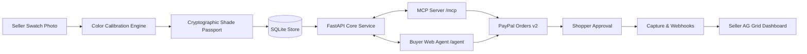

# Findable

> **"Toffee isn't a colour. ΔE 1.8 is."**
>
> One phone photo turns a small beauty brand's swatches into measured, cryptographically verifiable shade data that AI shopping agents can match, compare, and prepare for purchase directly through PayPal.

[](LICENSE)
[](https://www.python.org/downloads/)
[](https://fastapi.tiangolo.com)
[](https://developer.paypal.com)
[](https://modelcontextprotocol.io)
[](https://www.ag-grid.com)

---

## The Problem

- **Small brands use subjective names**: Independent beauty brands name their shades "Honey", "Toffee", or "Almond". A name is not an optical coordinate. AI shopping agents cannot match subjective naming against a customer's complexion, routinely routing buyers toward conglomerate brands with proprietary shade-matching apps.
- **High Return Rates**: Retail industry benchmarks show apparel and beauty return rates hover around 20–30%, with e-commerce averages at ~24.4% per National Retail Federation 2023 reports, overwhelmingly driven by shade and undertone mismatches.
- **Cart Abandonment**: 60% of online shoppers hesitate to buy foundation without an objective shade validation tool (*Arbelle*).

---

## The Solution: Findable

Findable empowers small indie sellers like Priya to create **Shade Passports** using nothing more than a smartphone photograph:
1. **Physical Normalization**: Swatches are photographed alongside standard printer paper as a lighting calibration standard.
2. **Color Calibration**: Inverts sRGB, computes von Kries linear channel balancing against the paper reference, strips texture/glare outliers, and maps values to CIELAB $(L^*, a^*, b^*)$ under standard D65 illuminant using NumPy, Pillow, and scikit-image.
3. **Derived Metrics**: Calculates Individual Typology Angle ($\text{ITA}^\circ$), depth classification, hue angle undertone (Warm, Neutral, Cool), and measurement confidence index.
4. **Shade Passport Cryptography**: Every shade is packaged into a canonical JSON passport, hashed with SHA-256, and signed via HMAC-SHA256 (tamper-evident, signed by Findable).
5. **Agent Discovery & Tool Calling via MCP**: An MCP server mounts at `/mcp`, permitting agents like Claude Desktop to search products, match shades using mathematical CIEDE2000 color difference ($\Delta E_{00}$), and initialize server-priced PayPal checkouts.
6. **PayPal Checkout & Verified Webhooks**: The agent prepares the order with server-authoritative pricing; the shopper approves in PayPal. Capture returns verify the transaction, and cryptographic webhook signatures post the order to the seller's AG Grid dashboard.

---

## System Architecture



For full sequence diagrams, mathematical formulas, and data models, see [ARCHITECTURE.md](ARCHITECTURE.md).

---

## Tech Stack

| Layer | Component | Description |
|---|---|---|
| **Backend** | Python 3.11+, FastAPI, Uvicorn, SQLModel | Single high-performance asynchronous service |
| **Frontend** | Jinja2 Templates, Tailwind CSS (CDN), Vanilla JS / HTMX | Server-rendered, responsive, zero-build toolchain |
| **Grids & Tables** | AG Grid Community (CDN) | Interactive seller shade catalogue & real-time order stream |
| **Color Science** | NumPy, Pillow, scikit-image | von Kries white balancing, CIELAB conversion, $\Delta E_{00}$ |
| **Agent / MCP** | FastMCP (`mcp` 2.x), Groq `llama-3.3-70b-versatile` | Streamable HTTP endpoint at `/mcp` & conversational web agent via OpenAI-compatible tool calling |
| **Payments** | PayPal REST APIs (Orders v2, Payments v2, Webhooks) | Secure server-side order creation, captures, refunds, webhooks |
| **Database** | SQLite + SQLModel ORM | Embedded relational database with automatic seed data |
| **Deployment** | Render (`render.yaml`, plan: free) | Instant deployable cloud blueprint |

---

## PayPal API Integration

All financial calculations and price resolutions are server-authoritative (agents can specify quantity and shade, never unit price):

| PayPal API | Endpoint | Implementation File | Purpose |
|---|---|---|---|
| **Auth** | `POST /v1/oauth2/token` | `app/paypal/client.py` | OAuth2 Bearer token acquisition with in-memory caching |
| **Orders v2 (Create)** | `POST /v2/checkout/orders` | `app/paypal/client.py` | Creates order with server-verified prices & passport bundle hash in `custom_id` |
| **Orders v2 (Capture)** | `POST /v2/checkout/orders/{id}/capture` | `app/paypal/client.py` | Captures funds upon shopper return from PayPal |
| **Payments v2 (Refund)** | `POST /v2/payments/captures/{id}/refund` | `app/paypal/client.py` | Disburses verified refunds against captured orders |
| **Webhooks Verification** | `POST /v1/notifications/verify-webhook-signature` | `app/paypal/webhooks.py` | Cryptographically validates incoming webhooks against PayPal public keys |

---

## AI Model & Tool Calling

- **Model**: Groq `llama-3.3-70b-versatile` with tool calling via the OpenAI-compatible API (`app/llm/agent.py`).
- **Tools**:
  - `search_products`: Filter products by price, coverage, finish, depth.
  - `match_shade`: Calculate mathematical CIEDE2000 $\Delta E$ between reference code and catalog shades.
  - `get_shade_passport`: Fetch canonical JSON hash and HMAC signature.
  - `create_checkout`: Prepare a verified PayPal checkout with server-authoritative pricing.
  - `get_order_status`: Real-time order telemetry tracking.
- **Offline Fallback**: When `GROQ_API_KEY` is not configured, the agent executes local deterministic tool calling so judges can evaluate full capabilities without API quota limits.

---

## Repository Structure

```text
.
├── ARCHITECTURE.md              # Detailed architecture, flows, and color maths
├── DEVPOST.md                   # Hackathon submission summary and fields
├── LICENSE                      # MIT Open Source License
├── README.md                    # Project overview, setup, and evaluation guide
├── render.yaml                  # Render deployment configuration (free plan)
├── requirements.txt             # Python runtime dependencies
├── .env.example                 # Example configuration template
├── app/
│   ├── main.py                  # FastAPI entry point, page & API routes, mounts /mcp
│   ├── config.py                # Pydantic Settings configuration loader
│   ├── db.py                    # SQLite database engine & session dependency
│   ├── models.py                # SQLModel table definitions (Shop, Product, Shade, Order, etc.)
│   ├── passport.py              # Canonical JSON hashing & HMAC signing engine
│   ├── services.py              # Search, match, checkout, and status service layer
│   ├── mcp_server.py            # Model Context Protocol tools & streamable HTTP
│   ├── color/
│   │   ├── __init__.py
│   │   ├── pipeline.py          # White balance, crop, linearize, LAB conversion
│   │   └── metrics.py           # ITA, depth, undertone, confidence, and ΔE2000 metrics
│   ├── llm/
│   │   ├── __init__.py
│   │   ├── client.py            # Text generation wrapper with offline fallback
│   │   ├── listing.py           # Product listing draft helper
│   │   └── agent.py             # Shopper conversational agent with Groq tool calling
│   ├── paypal/
│   │   ├── __init__.py
│   │   ├── client.py            # PayPal Orders v2, Payments v2, OAuth client
│   │   └── webhooks.py          # PayPal webhook signature verification & idempotency
│   ├── templates/               # Jinja2 HTML templates
│   │   ├── base.html            # Global layout with Tailwind CDN and navigation
│   │   ├── studio.html          # Seller photo upload, canvas box drawing & AG Grid
│   │   ├── agent.html           # Shopper conversational agent & match cards
│   │   ├── dashboard.html       # Seller orders & PayPal API call telemetry
│   │   ├── shop.html            # Public storefront with PayPal buttons
│   │   ├── measure.html         # Shopper current-foundation calibration tool
│   │   ├── passport.html        # Public Shade Passport verification page
│   │   └── judges.html          # 3-minute hackathon judge evaluation walkthrough
│   └── static/                  # Static assets (CSS, JS)
├── bench/                       # Benchmarks documentation
│   └── README.md                # Real measurement benchmark roadmap
└── tests/                       # Test suites
    ├── test_color.py            # Tests for color conversion and ΔE2000 accuracy
    ├── test_passport.py         # Tests for canonical hashing and HMAC verification
    ├── test_paypal.py           # Tests for PayPal client payload and mock execution
    ├── test_prompt3.py          # Tests for buyer reference and matching
    ├── test_prompt4.py          # Tests for PayPal sandbox hardening and idempotency
    ├── test_prompt5.py          # Tests for Groq tool calling agent and draft endpoints
    └── test_prompt6.py          # Tests for MCP server tools and streamable HTTP mount
```

---

## Quickstart & Local Setup

### 1. Prerequisites
- Python 3.11 or higher
- Git

### 2. Installation
```bash
# Clone the repository
git clone https://github.com/sury228/FINDABLE.git
cd FINDABLE

# Create and activate a virtual environment
python -m venv .venv
# On Windows:
.venv\Scripts\activate
# On macOS/Linux:
source .venv/bin/activate

# Install dependencies
pip install -r requirements.txt
```

### 3. Configure Environment Variables
Copy the template configuration file:
```bash
cp .env.example .env
```
Edit `.env` with your sandbox credentials:
```env
# PayPal Sandbox Credentials
PAYPAL_CLIENT_ID=your_sandbox_client_id
PAYPAL_CLIENT_SECRET=your_sandbox_client_secret
PAYPAL_BASE_URL=https://api-m.sandbox.paypal.com
PAYPAL_WEBHOOK_ID=your_webhook_id

# AI / LLM Configuration
LLM_PROVIDER=groq
GROQ_API_KEY=your_groq_api_key
LLM_MODEL=llama-3.3-70b-versatile

# Application Settings
APP_BASE_URL=http://localhost:8000
DATABASE_URL=sqlite:///findable.db
PASSPORT_SECRET=replace_with_a_random_32_byte_hex_string
MOCK_PAYPAL=0  # Set to 1 to run offline without real PayPal credentials
```

### 4. Run the Application
```bash
uvicorn app.main:app --reload --host 0.0.0.0 --port 8000
```
Navigate in your browser to:
- **Judges Guided Demo**: [http://localhost:8000/judges](http://localhost:8000/judges)
- **Seller Studio**: [http://localhost:8000/studio](http://localhost:8000/studio)
- **Shopper / Agent**: [http://localhost:8000/agent](http://localhost:8000/agent)
- **Seller Dashboard**: [http://localhost:8000/dashboard](http://localhost:8000/dashboard)
- **MCP Discovery Info**: [http://localhost:8000/mcp-info](http://localhost:8000/mcp-info)

---

## Connecting Claude Desktop to Findable MCP

Findable exposes its Model Context Protocol tools via stdio or streamable HTTP.

### Option A: Standard Stdio Transport (Recommended for Claude Desktop)
Add Findable to your Claude Desktop configuration:

**macOS**: `~/Library/Application Support/Claude/claude_desktop_config.json`  
**Windows**: `%APPDATA%\Claude\claude_desktop_config.json`

```json
{
  "mcpServers": {
    "findable": {
      "command": "python",
      "args": ["-m", "app.mcp_server"],
      "cwd": "C:\\Users\\HP\\Desktop\\ml comp"
    }
  }
}
```

### Option B: Streamable HTTP Transport
With the Findable server running (`uvicorn app.main:app` on port 8000), Claude Desktop connects directly to the `/mcp` streamable endpoint:

```json
{
  "mcpServers": {
    "findable": {
      "command": "npx",
      "args": ["-y", "mcp-remote", "http://localhost:8000/mcp"]
    }
  }
}
```

### Available Tools
1. `search_products`: Search cosmetic products by keyword, category, price, undertone, depth.
2. `match_shade`: Calculate mathematical CIEDE2000 $\Delta E$ between a customer reference and catalog shades.
3. `get_shade_passport`: Retrieve SHA-256 canonical hash & HMAC-SHA256 signature for a shade.
4. `create_checkout`: Initialize a verified server-authoritative PayPal Orders v2 checkout.
5. `get_order_status`: Real-time PayPal order status tracking.

---

## Benchmarking

See [bench/README.md](bench/README.md) for the benchmark methodology roadmap. Synthetic or simulated benchmarks have been omitted to uphold scientific measurement integrity.

---

## Testing

Run unit and integration tests using pytest:

```bash
pytest tests/ -v
```

---

## License

This project is licensed under the [MIT License](LICENSE).
